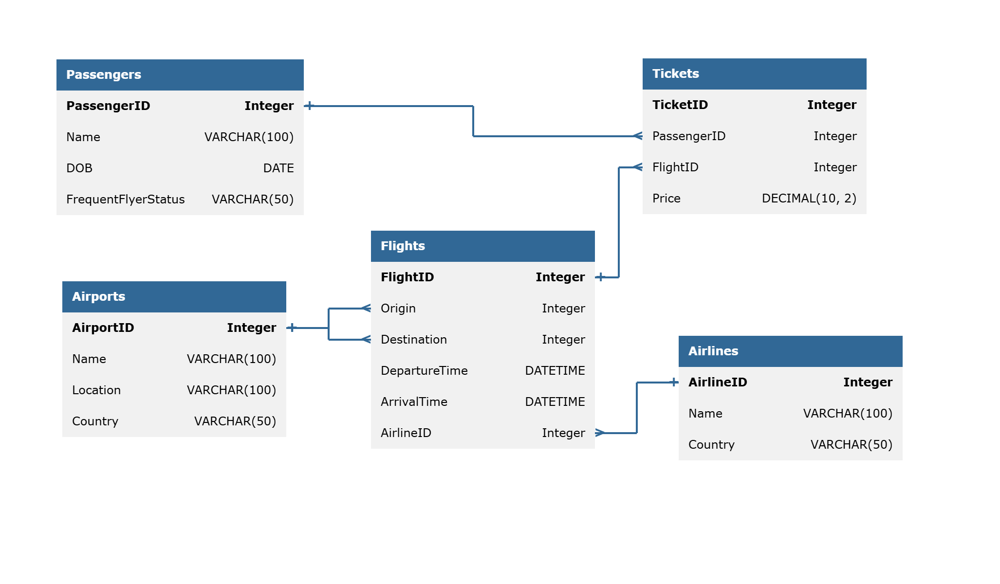

# Flight Reservation Database & SQL Analysis (SQL Server)

<div align="center">


### A Relational Flight-Booking Database Built from Scratch in SQL Server, with 10 Business Queries Using Joins, CTEs and Window Functions

[📊 Live Portfolio Overview](https://nady-07.github.io/portfolio/#projects) · [📥 Browse the SQL Scripts](./sql) · [💼 Connect on LinkedIn](https://www.linkedin.com/in/mohamed-alnady-52b87123b)

</div>

---

## 📌 Executive Summary

Airlines and ticketing platforms run on relational data: who flew, where, on which carrier, and for how much. Turning those tables into answers is the everyday job of a data analyst.

This project builds a complete **flight-booking database in SQL Server** and answers **10 business questions** against it. The schema has **5 normalized tables** (Airports, Airlines, Flights, Passengers and Tickets) linked by enforced foreign keys, and is loaded with **16 flights, 25 passengers and 54 tickets** from August 2025. The analysis covers airport traffic, airline revenue, flight duration, passenger behavior and loyalty-tier spending using **INNER JOINs, aggregations, CTEs and window functions** (`RANK() OVER (PARTITION BY ...)`).

The data shows **352,600 in total ticket revenue**, with **Delta Airlines** leading on both tickets (16) and revenue (93,600), and **Indira Gandhi International Airport (Delhi)** as the busiest departure point.

> **Note:** The data is sample data created for practice and does not come from a real airline or booking system.

---

## 🚀 Key Business Metrics & Findings

| Metric Domain | KPI | Value | Business Context & Insight |
| :--- | :--- | :--- | :--- |
| **Dataset Scale** | Records Loaded | **5 / 5 / 16 / 25 / 54** | Airports, airlines, flights, passengers and tickets, with all flights between 1 and 16 August 2025. |
| **Ticket Revenue** | Total Revenue | **352,600** | Average ticket price of **6,529.63**, ranging from 2,900 to **10,400**. |
| **Airline Performance** | Revenue Leader | **Delta Airlines** | **93,600** from 16 tickets (26.5% of revenue), ahead of Emirates (83,400), British Airways (71,700) and Air India (71,400). |
| **Smallest Carrier** | IndiGo | **32,500** | 5 tickets and 9.2% of revenue, all on flight 106 (Delhi to Mumbai). Its second flight (111) has no tickets. |
| **Airport Traffic** | Busiest Origin | **Indira Gandhi International (Delhi)** | **4 departures**, against 3 for each of the other four airports. |
| **Flight Duration** | Duration Mix | **11 Long · 4 Medium · 1 Short** | Based on hours between departure and arrival, with Short under 2h, Medium 2–5h and Long over 5h. |
| **Premium Pricing** | Highest Ticket | **10,400** | Dubai to Mumbai (flight 103), reached by two separate tickets (323 and 353). |
| **Customer Value** | Top Spender | **Meera Iyer (Silver)** | **26,900** across 4 tickets. Kabir Joshi leads the Platinum tier with 24,700. |
| **Capacity Utilization** | Flights with No Tickets | **6 of 16** | Flights 111 to 116 have no tickets in the data, so they are absent from the revenue and airline analysis. |

---

## 📸 Project Walkthrough & Architecture

### Data Model: Relational Schema
Five tables follow a classic booking structure: **Tickets** link a **Passenger** to a **Flight**, and each **Flight** links an origin and destination **Airport** and an operating **Airline**.



* **`Airports`** — `AirportID` (PK), name, city and country. Referenced twice by `Flights` (origin and destination).
* **`Airlines`** — `AirlineID` (PK), name and country.
* **`Flights`** — `FlightID` (PK), `Origin` and `Destination` (FKs to `Airports`), departure and arrival times, and `AirlineID` (FK to `Airlines`).
* **`Passengers`** — `PassengerID` (PK), name, date of birth and `FrequentFlyerStatus` (None, Silver, Gold or Platinum).
* **`Tickets`** — `TicketID` (PK), `PassengerID` and `FlightID` (FKs) and a `DECIMAL(10, 2)` price.

Design highlights:
* **Role-playing dimension:** `Flights` joins to `Airports` twice, so queries that show both ends of a route alias the table two times.
* **Referential integrity:** Every foreign key is enforced, so a ticket cannot reference a missing passenger or flight.
* **Rerunnable setup:** The create script drops and rebuilds the `Flight` database, so it can be run repeatedly.

---

### Analysis: 10 Business Questions
All queries are in [`sql/sql02_analysis_queries.sql`](./sql/sql02_analysis_queries.sql). Each one is documented with its question, expected output, tables and method.

| # | Business Question | Techniques | Result |
| :-: | :--- | :--- | :--- |
| **Q1** | Which airport has the most departures? | `INNER JOIN`, `COUNT`, `GROUP BY`, `TOP 1` | **Indira Gandhi International (Delhi)** with 4 flights. |
| **Q2** | How many tickets did each airline sell? | Multi-table join, `GROUP BY` | Delta **16**, Emirates **11**, British Airways **11**, Air India **11**, IndiGo **5**. |
| **Q3** | Which flights does IndiGo operate, with airport names? | Self-joined `Airports` (origin and destination), `WHERE` | Flight **106** Delhi to Mumbai and flight **111** Mumbai to Delhi. |
| **Q4** | Which airline has the most departures at each airport? | CTE, `RANK() OVER (PARTITION BY ...)` | Emirates leads Dubai, British Airways leads Heathrow, Air India leads Delhi and Delta leads New York (JFK), each with 3 flights. Mumbai is a three-way tie at 1 flight. |
| **Q5** | How long is each flight, and is it Short, Medium or Long? | `DATEDIFF`, `CASE` | **11 Long, 4 Medium, 1 Short** (flight 116, Delhi to Mumbai). |
| **Q6** | When did each passenger take their first and last flight, and how many tickets do they hold? | `MIN`, `MAX`, `COUNT`, 3-table join | **Meera Iyer** holds the most tickets (4). Swati Aggarwal is the only passenger with a single ticket. |
| **Q7** | What is the highest ticket price on each route? | CTE, `RANK() OVER (PARTITION BY origin, destination)` | **10,400** on Dubai to Mumbai, then 9,900 on Mumbai to New York and Mumbai to Dubai. |
| **Q8** | Who spends the most within each frequent-flyer tier? | Two chained CTEs, `SUM`, `RANK()` | Silver: **Meera Iyer** 26,900. Platinum: **Kabir Joshi** 24,700. None: **Ananya Reddy** 20,700. Gold: **Aarav Sharma and Sanya Arora** tied at 17,600. |
| **Q9** | How much revenue and how many tickets does each airline have, ranked? | CTE, `SUM`, `COUNT`, `RANK() OVER` | 1. Delta 93,600 · 2. Emirates 83,400 · 3. British Airways 71,700 · 4. Air India 71,400 · 5. IndiGo 32,500. |
| **Q10** | Which airline does each passenger use most, including ties? | Two chained CTEs, `RANK() OVER (PARTITION BY passenger)` | Kabir Joshi, Sanya Arora, Kunal Rao, Tanvi Shetty and Devansh Saxena each favor **Emirates** (2 or 3 tickets). Most other passengers split evenly across two airlines. |

---

## 🧮 Selected Query Catalog

A few of the queries that show the main patterns used in the project. They are copied from the analysis script.

### 1. Aggregation with a Join — Q1
```sql
--Q1 Find the busiest airport by the number of flights take off
--output: airport, total_number_of_flights
--tables: airport, flights
--method: INNER JOIN(airport), Count(origin), GROUP BY(Airport)
SELECT   TOP 1 a.Name AS airport_name,
               COUNT(*) AS total_number_of_flights
FROM     Flights AS f
         INNER JOIN
         Airports AS a
         ON f.Origin = a.AirportID
GROUP BY a.Name
ORDER BY COUNT(*) DESC;
```

### 2. Top-N per Group with `RANK()` — Q4
```sql
--Q4 For each airport, show the top airline by number of flights departing from there
--output: airport_name, airline_name, total_number_flights
--tables: Flights, Airport, Airline
WITH     cte_rank_airline
AS       (SELECT   ap.Name AS airpoty_name,
                   a.Name AS airline_name,
                   COUNT(*) AS total_flights_airline,
                   RANK() OVER (PARTITION BY ap.Name ORDER BY COUNT(*) DESC) AS rank
          FROM     Flights AS f
                   INNER JOIN
                   Airlines AS a
                   ON f.AirlineID = a.AirlineID
                   INNER JOIN
                   Airports AS ap
                   ON f.Origin = ap.AirportID
          GROUP BY a.Name, ap.Name)
SELECT   airpoty_name,
         airline_name,
         total_flights_airline
FROM     cte_rank_airline
WHERE    [rank] = 1
ORDER BY total_flights_airline DESC;
```

### 3. Chained CTEs for Group Winners — Q8
```sql
--Q8 Find the highest spending passenger in each Frequent Flyer Status group
--output: passenger, flyer_group, total_spending
--tables: passengers, tickets
WITH   cte_total_spending
AS     (SELECT   p.PassengerID,
                 p.Name,
                 SUM(t.Price) AS total_spending
        FROM     Passengers AS p
                 INNER JOIN
                 Tickets AS t
                 ON t.PassengerID = p.PassengerID
        GROUP BY p.PassengerID, p.Name),
       cte_rank_status
AS     (SELECT c.Name,
               p.FrequentFlyerStatus,
               c.total_spending,
               RANK() OVER (PARTITION BY p.FrequentFlyerStatus ORDER BY c.total_spending DESC) AS rank_of_total_spending_status
        FROM   cte_total_spending AS c
               INNER JOIN
               Passengers AS p
               ON p.PassengerID = c.PassengerID)
SELECT Name,
       FrequentFlyerStatus,
       total_spending
FROM   cte_rank_status
WHERE  rank_of_total_spending_status = 1;
```

### 4. Ties Handled Correctly — Q10
```sql
--Q10. For each passenger, identify their most frequently used airline. If a passenger has multiple airlines
--     with the same highest usage, show all such airlines.
--output: passenger_name, most_frequently_used_airline,
--tables: flights, airline, passengers, tickets
WITH   cte_num_of_flights
AS     (SELECT   p.PassengerID,
                 p.Name AS passenger_name,
                 a.AirlineID,
                 a.Name AS airline_name,
                 COUNT(*) AS number_of_flights
        FROM     Passengers AS p
                 INNER JOIN
                 Tickets AS t
                 ON t.PassengerID = p.PassengerID
                 INNER JOIN
                 Flights AS f
                 ON t.FlightID = f.FlightID
                 INNER JOIN
                 Airlines AS a
                 ON f.AirlineID = a.AirlineID
        GROUP BY p.PassengerID, p.Name, a.AirlineID, a.Name),
       cte_airline_rank
AS     (SELECT PassengerID,
               passenger_name,
               airline_name,
               number_of_flights,
               RANK() OVER (PARTITION BY PassengerID ORDER BY number_of_flights DESC) AS airline_rank
        FROM   cte_num_of_flights)
SELECT PassengerID,
       passenger_name,
       airline_name,
       number_of_flights
FROM   cte_airline_rank
WHERE  airline_rank = 1;
```

---

## 💡 Findings & Recommended Next Steps

**Business takeaways**
1. **Delta is the revenue engine:** it sold 16 tickets and 93,600 in revenue, 26.5% of the total, from just three ticketed flights. Review pricing and capacity on those routes first.
2. **IndiGo has the smallest footprint:** 5 tickets and 9.2% of revenue, all on a single flight (106). Compare airlines per ticketed flight before judging performance.
3. **Delhi is the busiest hub:** it is the origin of 4 flights, so it is a natural focus for capacity and schedule planning.
4. **Six flights have no ticket data:** flights 111 to 116 appear nowhere in the revenue results. Confirm whether they are unsold or simply missing from the load.

**Query and data-quality notes**
1. **Count distinct flights in Q6.** Some passengers hold two tickets on the same flight (for example, passenger 202 has two on flight 107), so `COUNT(*)` counts tickets, not flights. Use `COUNT(DISTINCT f.FlightID)` to count flights.
2. **Add `ORDER BY` to Q2.** A `TOP 10` without `ORDER BY` returns rows in no guaranteed order.
3. **Alias the output columns in Q7.** Both airport names come back as `Name`, which is ambiguous.
4. **Use minutes for precise durations in Q5.** `DATEDIFF(HOUR, ...)` counts hour boundaries crossed, so flight 116 (1h 55m) shows as 1 hour. The Short, Medium and Long categories stay the same on this data, but `DATEDIFF(MINUTE, ...) / 60.0` is more accurate.
5. **Consider constraints.** A `CHECK (ArrivalTime > DepartureTime)` on `Flights` and indexes on the foreign-key columns would harden the schema as the data grows.

---

## 🛠️ How to Run the Project

1. **Prerequisites:** Install [SQL Server](https://www.microsoft.com/sql-server) (Developer or Express edition is free) and [SQL Server Management Studio](https://learn.microsoft.com/sql/ssms/download-sql-server-management-studio-ssms) or Azure Data Studio.
2. **Clone this repository:**
   ```bash
   git clone https://github.com/Nady-07/Flight-Database-SQL-Analysis.git
   ```
3. **Build the database:** Run [`sql/sql01_create_and_load_data.sql`](./sql/sql01_create_and_load_data.sql). It creates the `Flight` database, five tables and all sample data.
   > ⚠️ **Warning:** This script **drops any existing database named `Flight`** before recreating it. Do not run it on a server where you already have a `Flight` database you want to keep.
4. **Run the analysis:** Run [`sql/sql02_analysis_queries.sql`](./sql/sql02_analysis_queries.sql), either all at once or one query at a time.

### Repository structure
```
Flight-Database-SQL-Analysis/
├── sql/
│   ├── sql01_create_and_load_data.sql   # Database, tables, sample data
│   └── sql02_analysis_queries.sql       # 10 business queries
├── assets/
│   └── flight-erd.png                   # Entity relationship diagram
├── LICENSE
└── README.md
```

---

## 👨‍💻 Author & Contact

**Mohamed Al Nady** — *Data Analyst specializing in SQL, Power BI, DAX, and Data Warehousing*
* 🌐 **Portfolio:** [nady-07.github.io/portfolio](https://nady-07.github.io/portfolio/)
* 💼 **LinkedIn:** [linkedin.com/in/mohamed-alnady-52b87123b](https://www.linkedin.com/in/mohamed-alnady-52b87123b)
* 📧 **Email:** [mohamednady0@outlook.com](mailto:mohamednady0@outlook.com)
* 🐙 **GitHub:** [@Nady-07](https://github.com/Nady-07)
